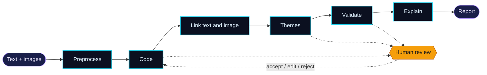

## 👋 About me

Computer Science student who enjoys turning course concepts into working projects, from database-backed web apps and 3D games to machine-learning pipelines. My thesis work looks at how **AI agents and human researchers can work together** on multimodal data.

- 🎓 Studying Computer Science at BRAC University
- 🔬 Working on my B.Sc. thesis on human-in-the-loop multi-agent vision-language models
- 🌱 Getting better at software engineering, machine learning, and clean code
- 🤝 Open to collaborating on projects and research

## 🔬 Current research

### Human-in-the-Loop Multi-Agent Vision-Language Framework for Qualitative Coding

Qualitative coding is slow, and most AI tools only read text even though real data (product reviews, Airbnb listings) comes with images. My thesis team and I are testing whether a **human-in-the-loop, multi-agent vision-language framework** can produce qualitative codes that are **more accurate and more explainable** than a single-agent VLM, under a matched token budget.

Each agent has one job, and human researchers can accept, edit, or reject the output at key stages:

`Multimodal AI` `Vision-Language Models` `Multi-Agent Systems` `Explainability` `Human-AI Collaboration`

## 🛠️ Tech I've worked with

## 📂 Featured projects

### 🏨 [Hotel Booking Status Classification (CSE422, AI)](https://github.com/Mehrun-NisaRahman/cse422-project)
A machine-learning project that predicts whether a hotel booking ends in check-out, cancellation, or no-show. Compares KNN, Logistic Regression, Naive Bayes, and a neural network on 119K bookings, with K-Means clustering on top. Reached 83% accuracy and 0.91 AUC.
`Python` `scikit-learn` `pandas`

### 🏍️ [Traffic Rider (CSE423, Computer Graphics)](https://github.com/Mehrun-NisaRahman/cse423-project)
A 3D endless-runner game built with Python and PyOpenGL. Dodge rocks across three lanes, collect coins and fuel, and survive as the difficulty ramps up. Includes a day/night cycle, boost mode, and first- and third-person cameras.
`Python` `PyOpenGL` `GLUT`

### 🛒 [Online Inventory & Order Management (CSE370, Databases)](https://github.com/Mehrun-NisaRahman/CSE370-Project-Section-07)
A buyer/seller web platform with product listings, a shopping cart, checkout and payments, order memos, and a quiz that earns buyers a discount. Backed by a relational MySQL schema.
`PHP` `MySQL`

### 🔧 [FixIt (CSE470, Software Engineering)](https://github.com/Sahela-Khan/FixIt-A-Local-Home-Services-Booking-Platform)
A platform where homeowners can browse and book local service providers such as electricians, plumbers, and cleaners, and track job status in real time. Built as a team project.
`JavaScript`

## 📫 Get in touch

---

⭐ Thanks for stopping by!

