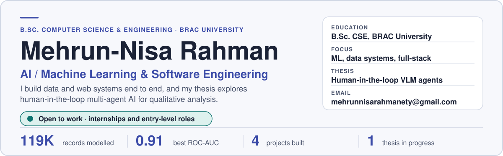
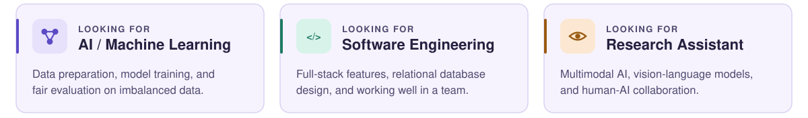
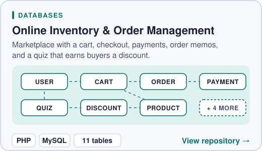
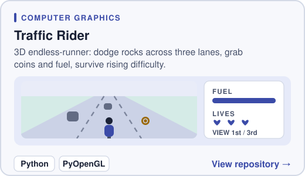
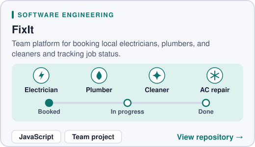
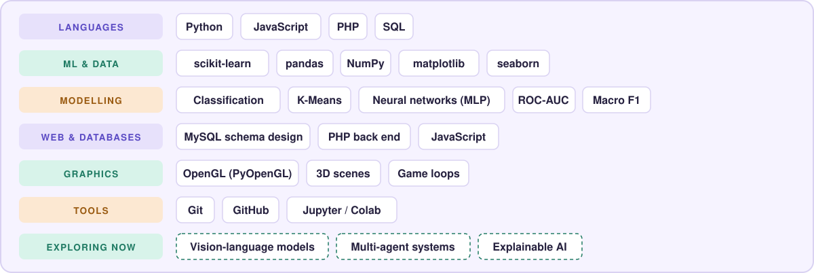
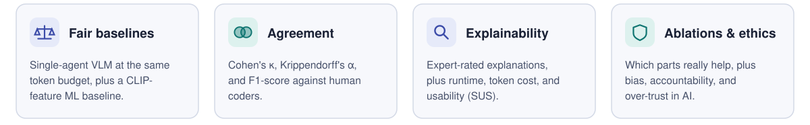

<picture>
  <source media="(prefers-color-scheme: dark)" srcset="banner-dark.svg">
  
</picture>

<picture><source media="(prefers-color-scheme: dark)" srcset="btn-status-dark.svg"></picture>
<a href="mailto:mehrunnisarahmanety@gmail.com"><picture><source media="(prefers-color-scheme: dark)" srcset="btn-email-dark.svg"></picture></a>
<a href="https://www.linkedin.com/in/mehrun-nisa-rahman-a42566242/"><picture><source media="(prefers-color-scheme: dark)" srcset="btn-linkedin-dark.svg"></picture></a>
<a href="https://x.com/mehrun_nisa_"><picture><source media="(prefers-color-scheme: dark)" srcset="btn-x-dark.svg"></picture></a>

<picture>
  <source media="(prefers-color-scheme: dark)" srcset="divider-dark.svg">
  
</picture>

## About me

I'm **Mehrun-Nisa Rahman**, a Computer Science student at **BRAC University** who loves turning ideas into working software. I build things end to end: a **database-backed marketplace**, a **machine-learning pipeline on 119K records**, a **3D game**, and a **team platform for booking home services**. My thesis explores **AI agents that work alongside human researchers** on text and image data.

> [!IMPORTANT]
> **I'm open to work.** I'm looking for **internships and entry-level roles** in **AI / machine learning** and **software engineering**. The quickest way to reach me is [email](mailto:mehrunnisarahmanety@gmail.com) or [LinkedIn](https://www.linkedin.com/in/mehrun-nisa-rahman-a42566242/).

## What I'm looking for

<picture>
  <source media="(prefers-color-scheme: dark)" srcset="roles-dark.svg">
  
</picture>

<picture>
  <source media="(prefers-color-scheme: dark)" srcset="divider-dark.svg">
  
</picture>

## Projects

  <a href="https://github.com/Mehrun-NisaRahman/cse422-project">
    <picture>
      <source media="(prefers-color-scheme: dark)" srcset="project-hotel-dark.svg">
      
    </picture>
  </a>
  <a href="https://github.com/Mehrun-NisaRahman/CSE370-Project-Section-07">
    <picture>
      <source media="(prefers-color-scheme: dark)" srcset="project-market-dark.svg">
      
    </picture>
  </a>
  <a href="https://github.com/Mehrun-NisaRahman/cse423-project">
    <picture>
      <source media="(prefers-color-scheme: dark)" srcset="project-rider-dark.svg">
      
    </picture>
  </a>
  <a href="https://github.com/Sahela-Khan/FixIt-A-Local-Home-Services-Booking-Platform">
    <picture>
      <source media="(prefers-color-scheme: dark)" srcset="project-fixit-dark.svg">
      
    </picture>
  </a>

Click any card to open the repository.

## Skills

<picture>
  <source media="(prefers-color-scheme: dark)" srcset="skills-dark.svg">
  
</picture>

<picture>
  <source media="(prefers-color-scheme: dark)" srcset="divider-dark.svg">
  
</picture>

## From coursework to thesis

<picture>
  <source media="(prefers-color-scheme: dark)" srcset="journey-dark.svg">
  
</picture>

## Thesis: Human-in-the-Loop Multi-Agent Vision-Language Framework

Qualitative coding is slow, and most AI tools only read text even though real data (product reviews, Airbnb listings) comes with images. My thesis team and I are investigating whether a **human-in-the-loop, multi-agent vision-language framework** can produce qualitative codes that are **more accurate and more explainable** than a single-agent VLM, under a matched token budget.

Seven specialised agents each have one job. Human researchers review the output after coding and after theme extraction, and can accept, edit, or reject it. Every code and theme points back to its text and image evidence.

```mermaid
flowchart LR
    D([Text + images]) --> P[Preprocess]
    P --> C[Code]
    C --> H1{{Human review}}
    H1 --> X[Cross-modal reasoning]
    X --> T[Theme extraction]
    T --> H2{{Human review}}
    H2 --> V[Validate]
    V --> E[Explain]
    E --> R([Report])
    H1 -.->|reject / edit| C
    H2 -.->|reject / edit| T
    classDef agent fill:#E4DEFC,stroke:#7B68E0,stroke-width:2px,color:#26213F
    classDef human fill:#FBE3C6,stroke:#D98A2B,stroke-width:2px,color:#26213F
    classDef io fill:#CFF1E6,stroke:#3FAE8C,stroke-width:2px,color:#26213F
    class P,C,X,T,V,E agent
    class H1,H2 human
    class D,R io
```

**How it will be evaluated** (on public multimodal data such as Amazon reviews with images, Yelp, and Airbnb listings)

<picture>
  <source media="(prefers-color-scheme: dark)" srcset="thesis-eval-dark.svg">
  
</picture>

`Multimodal AI` `Vision-Language Models` `Multi-Agent Systems` `Explainability` `Human-AI Collaboration`

<picture>
  <source media="(prefers-color-scheme: dark)" srcset="divider-dark.svg">
  
</picture>

## How I work

> [!TIP]
> - **I check before I trust a number.** Leakage, class imbalance, and the right metrics come before any accuracy claim.
> - **I compare fairly.** Matched budgets and proper baselines, so gains come from the design.
> - **I keep people in control.** AI output should be reviewable, explainable, and easy to correct.

## Let's talk

If you're hiring or want to collaborate, I'd love to hear from you.

<a href="mailto:mehrunnisarahmanety@gmail.com"><picture><source media="(prefers-color-scheme: dark)" srcset="btn-email-dark.svg"></picture></a>
<a href="https://www.linkedin.com/in/mehrun-nisa-rahman-a42566242/"><picture><source media="(prefers-color-scheme: dark)" srcset="btn-linkedin-dark.svg"></picture></a>
<a href="https://x.com/mehrun_nisa_"><picture><source media="(prefers-color-scheme: dark)" srcset="btn-x-dark.svg"></picture></a>
<a href="https://www.facebook.com/mehrunnisarahman.ety"><picture><source media="(prefers-color-scheme: dark)" srcset="btn-facebook-dark.svg"></picture></a>

<!-- To add your resume, delete the comment markers around the next line and replace YOUR_RESUME_LINK:

-->

<picture>
  <source media="(prefers-color-scheme: dark)" srcset="divider-dark.svg">
  
</picture>

Thanks for stopping by.

