

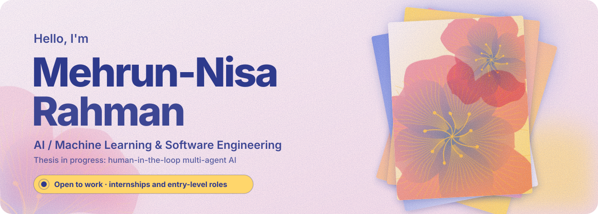

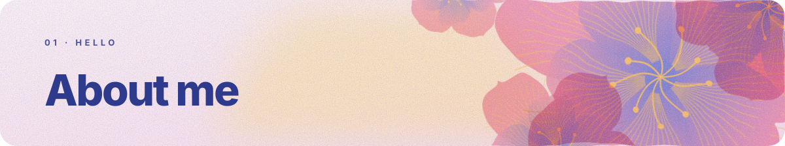

I'm **Mehrun-Nisa Rahman**, a Computer Science student at **BRAC University** who loves turning ideas into working software. I build things end to end: a **database-backed marketplace**, a **machine-learning pipeline on 119K records**, a **3D game**, and a **team platform for booking home services**. My thesis explores **AI agents that work alongside human researchers** on text and image data.

> [!IMPORTANT]
> **I'm open to work.** I'm looking for **internships and entry-level roles** in **AI / machine learning** and **software engineering**. The quickest way to reach me is [email](mailto:mehrunnisarahmanety@gmail.com) or [LinkedIn](https://www.linkedin.com/in/mehrun-nisa-rahman-a42566242/).

  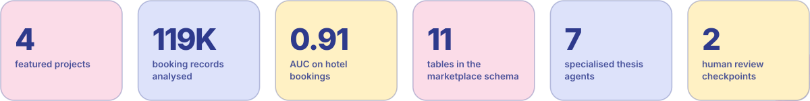

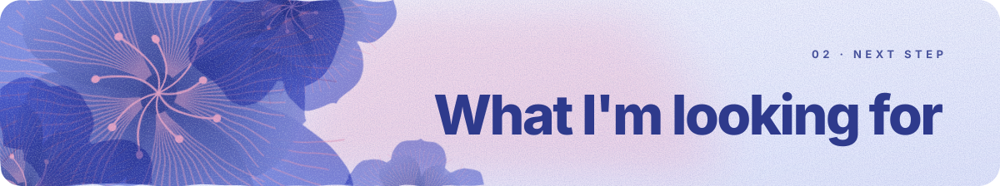

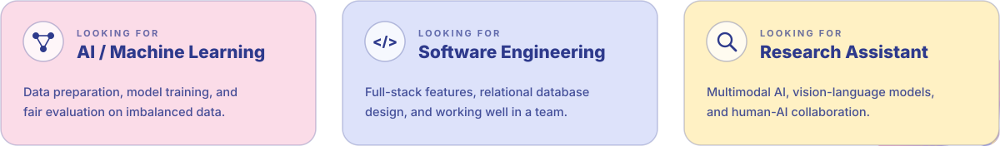

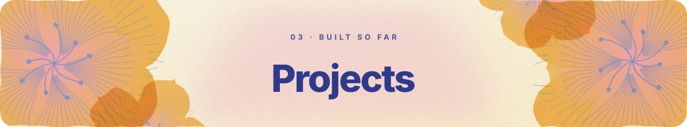

  <a href="https://github.com/Mehrun-NisaRahman/cse422-project">
    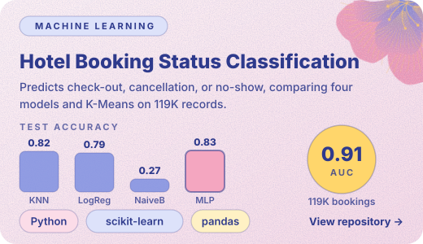
  </a>
  <a href="https://github.com/Mehrun-NisaRahman/CSE370-Project-Section-07">
    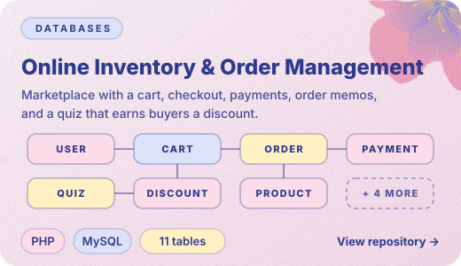
  </a>
  <a href="https://github.com/Mehrun-NisaRahman/cse423-project">
    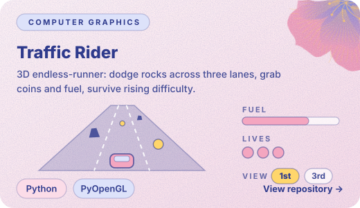
  </a>
  <a href="https://github.com/Sahela-Khan/FixIt-A-Local-Home-Services-Booking-Platform">
    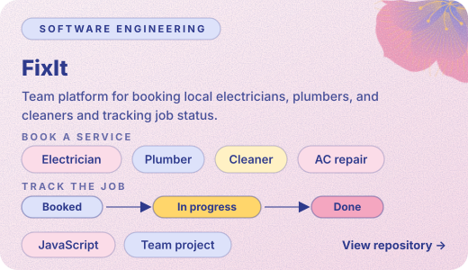
  </a>

Click any card to open the repository.

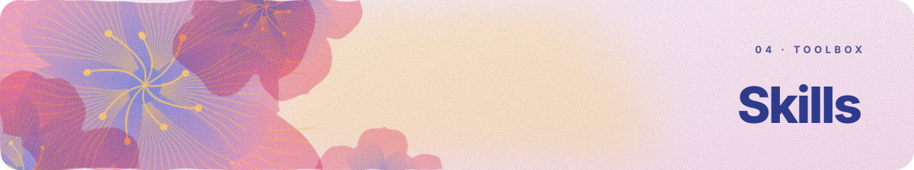

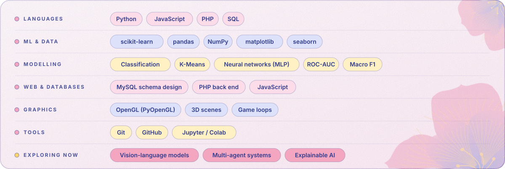

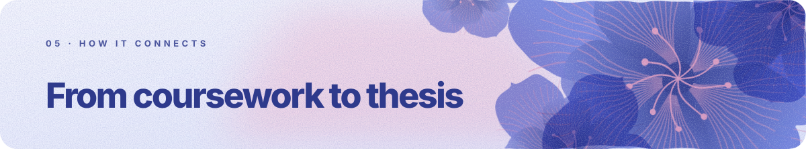

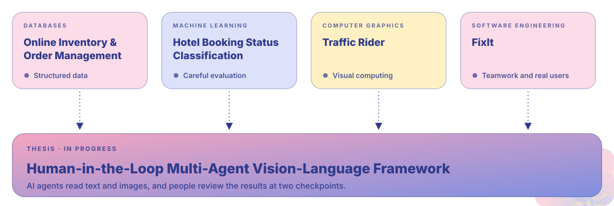

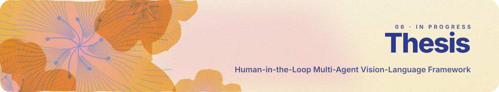

Qualitative coding is slow, and most AI tools only read text even though real data (product reviews, Airbnb listings) comes with images. My thesis team and I are investigating whether a **human-in-the-loop, multi-agent vision-language framework** can produce qualitative codes that are **more accurate and more explainable** than a single-agent VLM, under a matched token budget.

Seven specialised agents each have one job. Human researchers review the output after coding and after theme extraction, and can accept, edit, or reject it. Every code and theme points back to its text and image evidence.

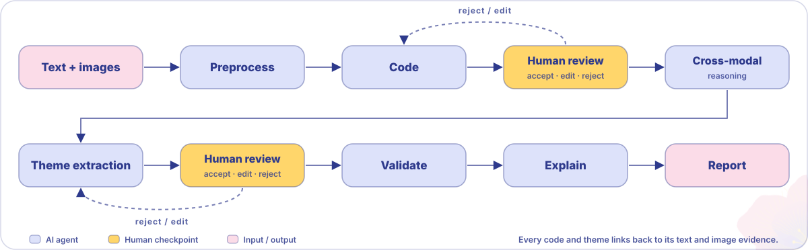

**How it will be evaluated** (on public multimodal data such as Amazon reviews with images, Yelp, and Airbnb listings)

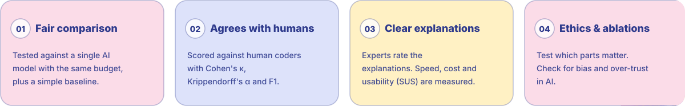

  

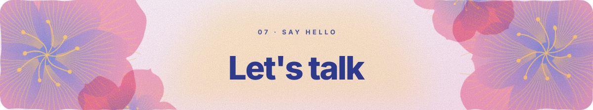

If you're hiring or want to collaborate, I'd love to hear from you.

<!-- To add your resume, delete the comment markers around the next line and replace YOUR_RESUME_LINK:

-->

Thanks for stopping by.

