 

## 🌸 About

I'm a **Computer Science** student with a growing love for programming. I like turning course ideas into working things: booking platforms, databases, and a bit of everything in between.

- 🌱 Currently studying Computer Science
- 👀 Interested in programming and software engineering
- 📫 Reach me on [Facebook](https://www.facebook.com/mehrunnisarahman.ety)

## 🎨 Stack

  
  
  
  
  

## 🌼 Projects

| Project | What it is | Built with |
| :-- | :-- | :-- |
| [**FixIt**](https://github.com/Sahela-Khan/FixIt-A-Local-Home-Services-Booking-Platform) | CSE470 (Software Engineering) course project: homeowners browse and book local service providers such as electricians, plumbers, cleaners and AC repair, and track job status | JavaScript |
| [**cse423-project**](https://github.com/Mehrun-NisaRahman/cse423-project) | CSE423 course project | Python |
| [**CSE370-Project-Section-07**](https://github.com/Mehrun-NisaRahman/CSE370-Project-Section-07) | CSE370 course project, Section 07 | PHP |

Always growing 🌸

